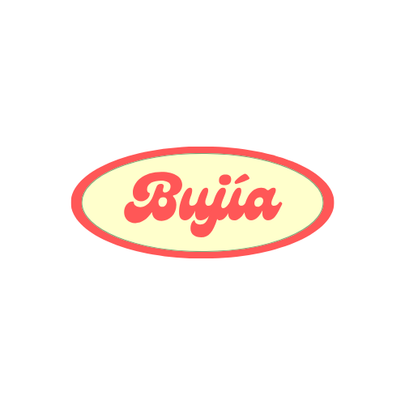
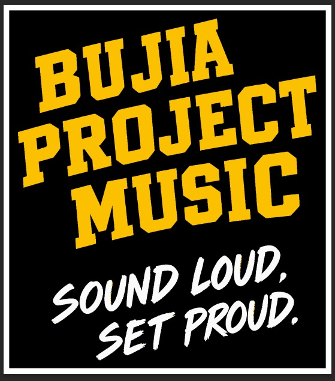
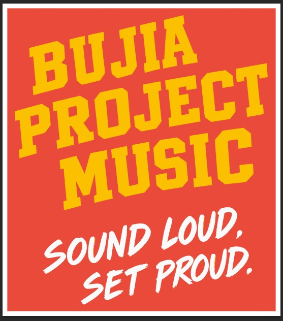
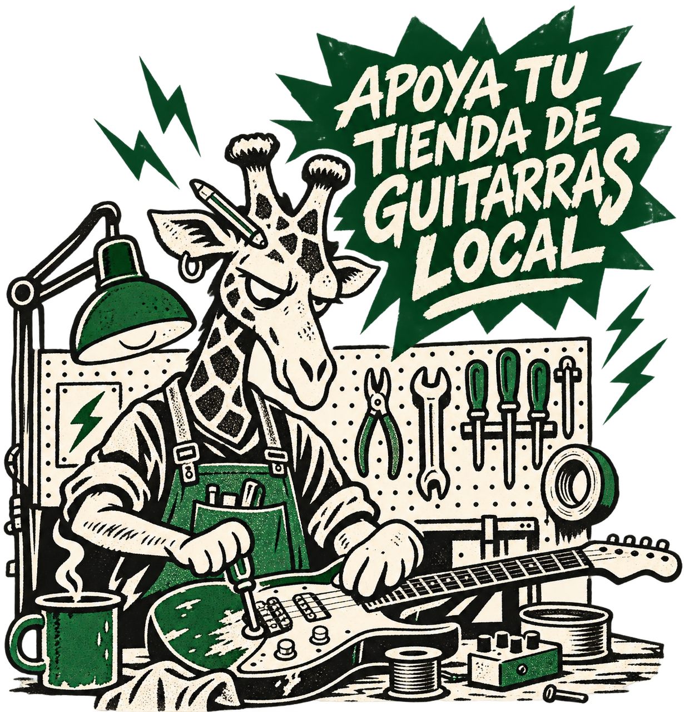
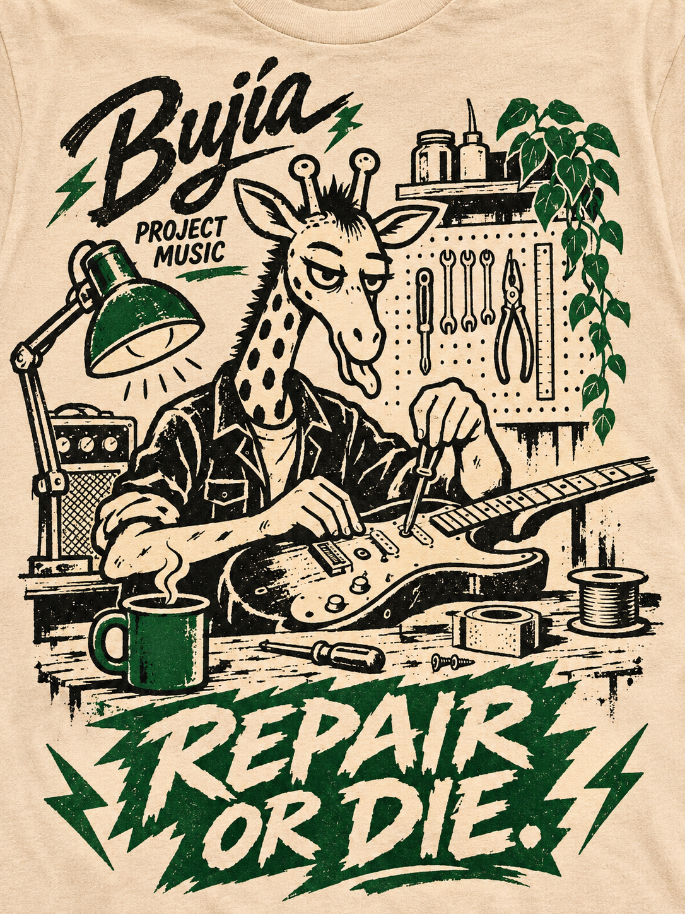
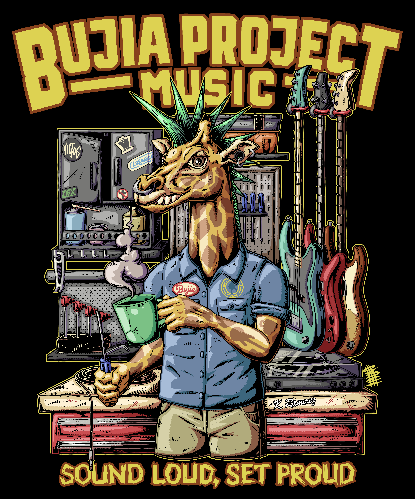
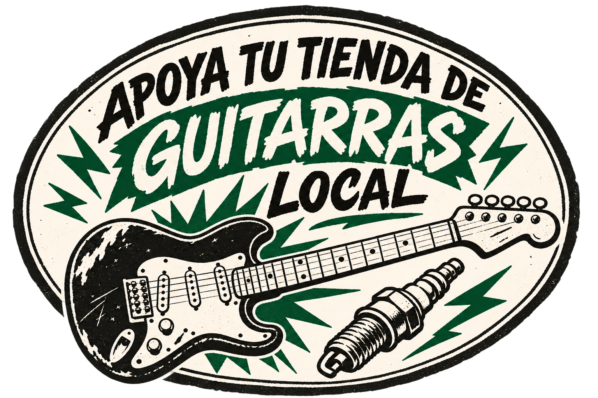
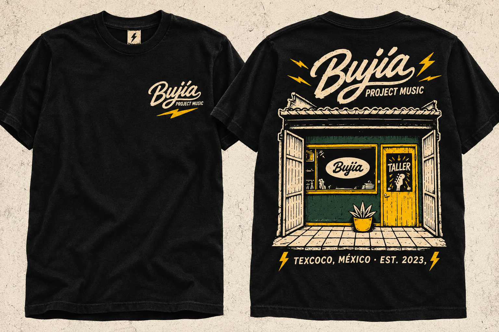
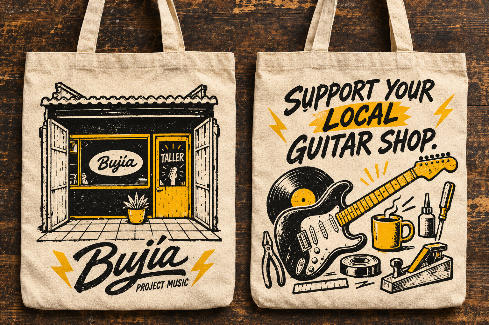

# Catálogo de recursos

## Logotipos

| Identificador | Nombre | Categoría | Procedencia | Versión | Vista previa | Archivo | Estado | Maestra relacionada | Descripción |
| --- | --- | --- | --- | --- | --- | --- | --- | --- | --- |
| `bujia-oval-logo` | [Logo ovalado principal de Bujía](masters/logo/bujia-oval-logo-v1.0.0-red-cream.md) | `logo` | `human` | `1.0.0` |  | [PNG](masters/logo/bujia-oval-logo-v1.0.0-red-cream.png) | `approved` | [Este archivo](masters/logo/bujia-oval-logo-v1.0.0-red-cream.png) | Rótulo manuscrito rojo en óvalo crema con contorno rojo y exterior transparente. |
| `bujia-wordmark-sticker` | [Logo tipográfico con fondo azul marino](designs/stickers/bujia-wordmark-sticker-v1.0.0-navy.md) | `stickers` | `unknown` | `1.0.0` |  | [JPEG](designs/stickers/bujia-wordmark-sticker-v1.0.0-navy.jpeg) | `approved` | — | Rótulo amarillo inclinado, lema blanco y marco claro sobre fondo azul marino. |
| `bujia-wordmark-sticker` | [Logo tipográfico con fondo negro](designs/stickers/bujia-wordmark-sticker-v1.1.0-black.md) | `stickers` | `unknown` | `1.1.0` |  | [JPEG](designs/stickers/bujia-wordmark-sticker-v1.1.0-black.jpeg) | `approved` | — | Rótulo amarillo inclinado, lema blanco y marco claro sobre fondo negro. |
| `bujia-wordmark-sticker` | [Logo tipográfico con fondo rojo](designs/stickers/bujia-wordmark-sticker-v1.2.0-red.md) | `stickers` | `unknown` | `1.2.0` |  | [JPEG](designs/stickers/bujia-wordmark-sticker-v1.2.0-red.jpeg) | `approved` | — | Rótulo amarillo inclinado, lema blanco y marco claro sobre fondo rojo. |

## Personajes

| Identificador | Nombre | Categoría | Procedencia | Versión | Vista previa | Archivo | Estado | Maestra relacionada | Descripción |
| --- | --- | --- | --- | --- | --- | --- | --- | --- | --- |

## Objetos

| Identificador | Nombre | Categoría | Procedencia | Versión | Vista previa | Archivo | Estado | Maestra relacionada | Descripción |
| --- | --- | --- | --- | --- | --- | --- | --- | --- | --- |

## Escenas

| Identificador | Nombre | Categoría | Procedencia | Versión | Vista previa | Archivo | Estado | Maestra relacionada | Descripción |
| --- | --- | --- | --- | --- | --- | --- | --- | --- | --- |
| `giraffe-at-workbench` | [Jirafa en el taller con lema de apoyo local](drafts/scenes/giraffe-at-workbench-v1.0.0-support-local.md) | `scenes` | `ai-generated` | `1.0.0` |  | [PNG](drafts/scenes/giraffe-at-workbench-v1.0.0-support-local.png) | `review` | — | Jirafa trabajando en una guitarra ante un panel de herramientas, en verde, crema y negro. |
| `giraffe-at-workbench` | [Jirafa en el taller con lema Repair or Die](drafts/scenes/giraffe-at-workbench-v1.1.0-repair-or-die.md) | `scenes` | `ai-generated` | `1.1.0` |  | [PNG](drafts/scenes/giraffe-at-workbench-v1.1.0-repair-or-die.png) | `review` | — | Jirafa reparando una guitarra en una escena verde y crema con el lema «Repair or Die». |
| `giraffe-workshop-illustration` | [Jirafa en el taller con taza verde](drafts/scenes/giraffe-workshop-illustration-v1.0.0-sound-loud-set-proud.md) | `scenes` | `human` | `1.0.0` |  | [PNG](drafts/scenes/giraffe-workshop-illustration-v1.0.0-sound-loud-set-proud.png) | `review` | — | Jirafa con taza verde en el taller, rodeada de instrumentos y acompañada del lema «Sound Loud, Set Proud». |

## Fachada

| Identificador | Nombre | Categoría | Procedencia | Versión | Vista previa | Archivo | Estado | Maestra relacionada | Descripción |
| --- | --- | --- | --- | --- | --- | --- | --- | --- | --- |
| `facade-sheet` | [Composición de fachada y banco de trabajo](drafts/facade/facade-sheet-v1.0.0-workbench-composition.md) | `facade` | `ai-generated` | `1.0.0` |  | [PNG](drafts/facade/facade-sheet-v1.0.0-workbench-composition.png) | `review` | — | Composición con fachada a la izquierda, banco de lutería a la derecha y rotulación del taller. |
| `facade` | [Fachada con lema de apoyo local](drafts/facade/facade-v1.0.0-support-local-banner.md) | `facade` | `ai-generated` | `1.0.0` |  | [PNG](drafts/facade/facade-v1.0.0-support-local-banner.png) | `review` | — | Fachada amarilla y negra con el lema «Apoya tu tienda de guitarras local» sobre el techo. |

## Elementos gráficos

| Identificador | Nombre | Categoría | Procedencia | Versión | Vista previa | Archivo | Estado | Maestra relacionada | Descripción |
| --- | --- | --- | --- | --- | --- | --- | --- | --- | --- |
| `support-local-guitar-shop` | [Apoya tu tienda local con bujía](drafts/graphic-elements/support-local-guitar-shop-v1.0.0-spark-plug.md) | `graphic-elements` | `ai-generated` | `1.0.0` |  | [PNG](drafts/graphic-elements/support-local-guitar-shop-v1.0.0-spark-plug.png) | `review` | — | Letrero en negro, amarillo y crema con bujía, guitarra, taza y útiles de taller. |
| `support-local-workshop` | [Apoya a tu taller local](drafts/graphic-elements/support-local-workshop-v1.0.0-yellow-lettering.md) | `graphic-elements` | `ai-generated` | `1.0.0` |  | [PNG](drafts/graphic-elements/support-local-workshop-v1.0.0-yellow-lettering.png) | `review` | — | Letras amarillas sobre negro con rayos, un clavijero y una taza. |
| `support-local-guitar-shop` | [Apoya tu tienda local con vinilo](drafts/graphic-elements/support-local-guitar-shop-v1.1.0-vinyl-and-tools.md) | `graphic-elements` | `ai-generated` | `1.1.0` |  | [PNG](drafts/graphic-elements/support-local-guitar-shop-v1.1.0-vinyl-and-tools.png) | `review` | — | Lema amarillo entre guitarra, vinilo, taza y herramientas. |
| `support-local-guitar-shop` | [Apoya tu tienda local en emblema ovalado](drafts/graphic-elements/support-local-guitar-shop-v1.2.0-green-oval.md) | `graphic-elements` | `ai-generated` | `1.2.0` |  | [PNG](drafts/graphic-elements/support-local-guitar-shop-v1.2.0-green-oval.png) | `review` | — | Emblema crema y verde con guitarra eléctrica, bujía y rayos. |

## Texturas

| Identificador | Nombre | Categoría | Procedencia | Versión | Vista previa | Archivo | Estado | Maestra relacionada | Descripción |
| --- | --- | --- | --- | --- | --- | --- | --- | --- | --- |

## Fotografías

| Identificador | Nombre | Categoría | Procedencia | Versión | Vista previa | Archivo | Estado | Maestra relacionada | Descripción |
| --- | --- | --- | --- | --- | --- | --- | --- | --- | --- |

## Diseños de merchandising

| Identificador | Nombre | Categoría | Procedencia | Versión | Vista previa | Archivo | Estado | Maestra relacionada | Descripción |
| --- | --- | --- | --- | --- | --- | --- | --- | --- | --- |
| `black-t-shirt` | [Mockup de playera negra con fachada](designs/t-shirts/black-t-shirt-v1.0.0-facade-mockup.md) | `t-shirts` | `ai-generated` | `1.0.0` |  | [PNG](designs/t-shirts/black-t-shirt-v1.0.0-facade-mockup.png) | `review` | — | Vista frontal y posterior con marca al pecho e ilustración de fachada en la espalda. |
| `canvas-totebag` | [Mockup de totebags con fachada y guitarra](designs/totebags/canvas-totebag-v1.0.0-facade-and-guitar-mockup.md) | `totebags` | `ai-generated` | `1.0.0` |  | [PNG](designs/totebags/canvas-totebag-v1.0.0-facade-and-guitar-mockup.png) | `review` | — | Dos bolsas de lona con fachada y una composición de guitarra con lema en inglés. |

## Otros diseños

| Identificador | Nombre | Categoría | Procedencia | Versión | Vista previa | Archivo | Estado | Maestra relacionada | Descripción |
| --- | --- | --- | --- | --- | --- | --- | --- | --- | --- |
