# Catálogo de recursos

## Logotipos

| Identificador | Nombre | Categoría | Procedencia | Versión | Vista previa | Archivo | Estado | Maestra relacionada | Descripción |
| --- | --- | --- | --- | --- | --- | --- | --- | --- | --- |
| `bujia-oval-logo` | [Logo ovalado principal de Bujía](masters/logo/bujia-oval-logo-v1.0.0-red-cream.md) | `logo` | `human` | `1.0.0` |  | [PNG](masters/logo/bujia-oval-logo-v1.0.0-red-cream.png) | `approved` | [Este archivo](masters/logo/bujia-oval-logo-v1.0.0-red-cream.png) | Rótulo manuscrito rojo en óvalo crema con contorno rojo y exterior transparente. |
| `bujia-wordmark-sticker` | [Logo tipográfico con fondo azul marino](designs/stickers/bujia-wordmark-sticker-v1.0.0-navy.md) | `stickers` | `unknown` | `1.0.0` | 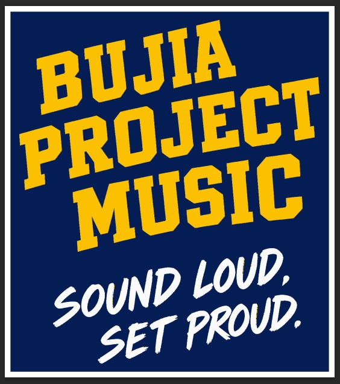 | [JPEG](designs/stickers/bujia-wordmark-sticker-v1.0.0-navy.jpeg) | `approved` | — | Rótulo amarillo inclinado, lema blanco y marco claro sobre fondo azul marino. |
| `bujia-wordmark-sticker` | [Logo tipográfico con fondo negro](designs/stickers/bujia-wordmark-sticker-v1.1.0-black.md) | `stickers` | `unknown` | `1.1.0` |  | [JPEG](designs/stickers/bujia-wordmark-sticker-v1.1.0-black.jpeg) | `approved` | — | Rótulo amarillo inclinado, lema blanco y marco claro sobre fondo negro. |
| `bujia-wordmark-sticker` | [Logo tipográfico con fondo rojo](designs/stickers/bujia-wordmark-sticker-v1.2.0-red.md) | `stickers` | `unknown` | `1.2.0` |  | [JPEG](designs/stickers/bujia-wordmark-sticker-v1.2.0-red.jpeg) | `approved` | — | Rótulo amarillo inclinado, lema blanco y marco claro sobre fondo rojo. |

## Personajes

| Identificador | Nombre | Categoría | Procedencia | Versión | Vista previa | Archivo | Estado | Maestra relacionada | Descripción |
| --- | --- | --- | --- | --- | --- | --- | --- | --- | --- |

## Objetos

| Identificador | Nombre | Categoría | Procedencia | Versión | Vista previa | Archivo | Estado | Maestra relacionada | Descripción |
| --- | --- | --- | --- | --- | --- | --- | --- | --- | --- |

## Escenas

| Identificador | Nombre | Categoría | Procedencia | Versión | Vista previa | Archivo | Estado | Maestra relacionada | Descripción |
| --- | --- | --- | --- | --- | --- | --- | --- | --- | --- |
| `giraffe-at-workbench` | [Jirafa en el taller con lema de apoyo local](drafts/scenes/giraffe-at-workbench-v1.0.0-support-local.md) | `scenes` | `ai-generated` | `1.0.0` |  | [PNG](drafts/scenes/giraffe-at-workbench-v1.0.0-support-local.png) | `review` | — | Jirafa trabajando en una guitarra ante un panel de herramientas, en verde, crema y negro. |
| `giraffe-at-workbench` | [Jirafa en el taller con lema Repair or Die](drafts/scenes/giraffe-at-workbench-v1.1.0-repair-or-die.md) | `scenes` | `ai-generated` | `1.1.0` |  | [PNG](drafts/scenes/giraffe-at-workbench-v1.1.0-repair-or-die.png) | `review` | — | Jirafa reparando una guitarra en una escena verde y crema con el lema «Repair or Die». |
| `giraffe-workshop-illustration` | [Jirafa en el taller con taza verde](drafts/scenes/giraffe-workshop-illustration-v1.0.0-sound-loud-set-proud.md) | `scenes` | `human` | `1.0.0` |  | [PNG](drafts/scenes/giraffe-workshop-illustration-v1.0.0-sound-loud-set-proud.png) | `review` | — | Jirafa con taza verde en el taller, rodeada de instrumentos y acompañada del lema «Sound Loud, Set Proud». |

## Fachada

| Identificador | Nombre | Categoría | Procedencia | Versión | Vista previa | Archivo | Estado | Maestra relacionada | Descripción |
| --- | --- | --- | --- | --- | --- | --- | --- | --- | --- |
| `facade-sheet` | [Composición de fachada y banco de trabajo](drafts/facade/facade-sheet-v1.0.0-workbench-composition.md) | `facade` | `ai-generated` | `1.0.0` | 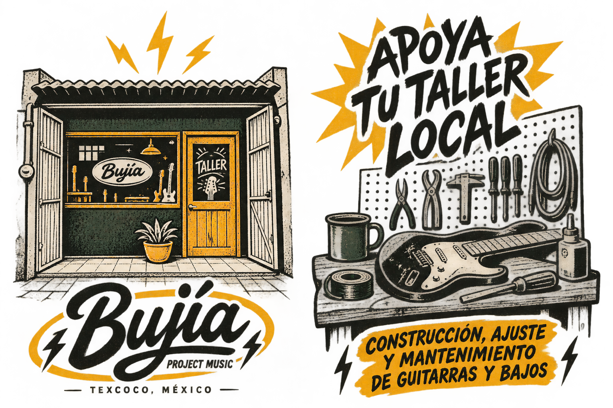 | [PNG](drafts/facade/facade-sheet-v1.0.0-workbench-composition.png) | `review` | — | Composición con fachada a la izquierda, banco de lutería a la derecha y rotulación del taller. |
| `facade` | [Fachada con lema de apoyo local](drafts/facade/facade-v1.0.0-support-local-banner.md) | `facade` | `ai-generated` | `1.0.0` | 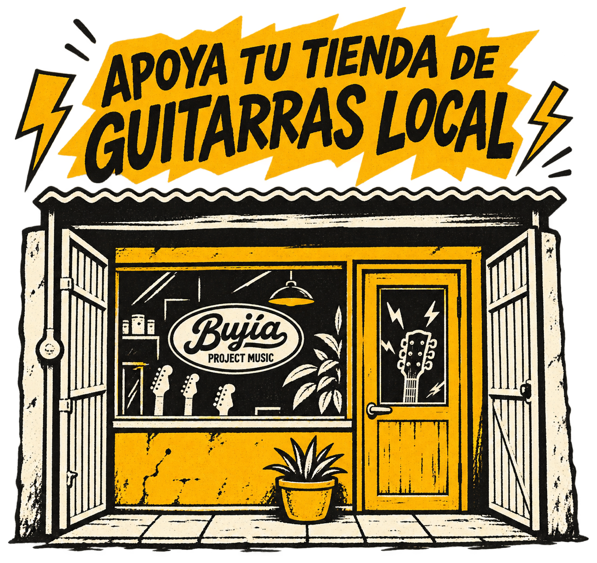 | [PNG](drafts/facade/facade-v1.0.0-support-local-banner.png) | `review` | — | Fachada amarilla y negra con el lema «Apoya tu tienda de guitarras local» sobre el techo. |
| `facade-sheet` | [Lámina de fachadas sobre blanco](drafts/facade/facade-sheet-v1.2.0-white-background.md) | `facade` | `ai-generated` | `1.2.0` | 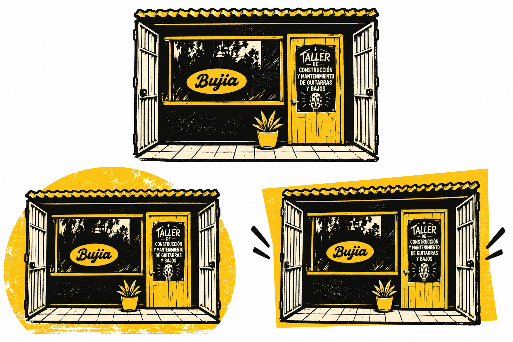 | [PNG](drafts/facade/facade-sheet-v1.2.0-white-background.png) | `review` | — | Lámina de tres composiciones conservada completa. |
| `facade` | [Fachada verde y crema](drafts/facade/facade-v1.2.0-green-cream.md) | `facade` | `ai-generated` | `1.2.0` | 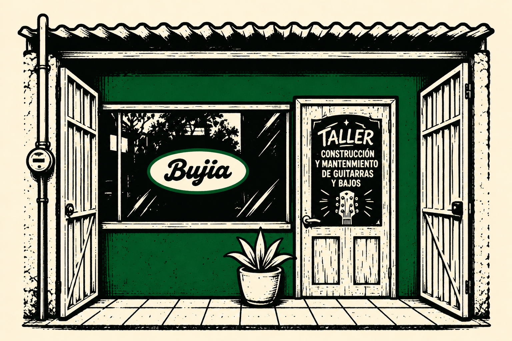 | [PNG](drafts/facade/facade-v1.2.0-green-cream.png) | `review` | — | Ilustración individual de la fachada del taller. |
| `facade` | [Fachada verde y amarilla](drafts/facade/facade-v1.3.0-green-yellow.md) | `facade` | `ai-generated` | `1.3.0` | 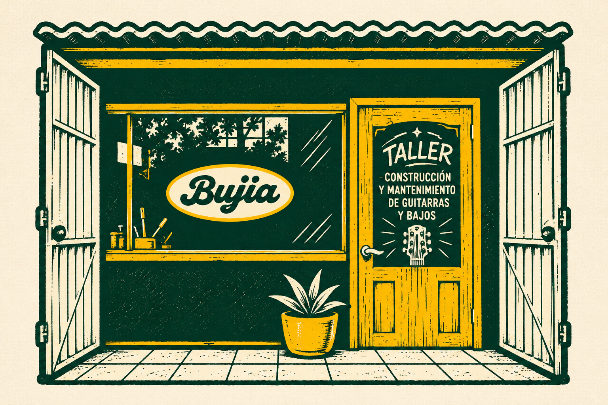 | [PNG](drafts/facade/facade-v1.3.0-green-yellow.png) | `review` | — | Ilustración individual de la fachada del taller. |
| `facade-sheet` | [Lámina de fachadas sobre crema](drafts/facade/facade-sheet-v1.3.0-cream-background.md) | `facade` | `ai-generated` | `1.3.0` | 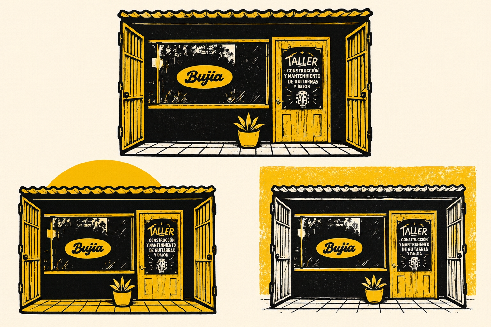 | [PNG](drafts/facade/facade-sheet-v1.3.0-cream-background.png) | `review` | — | Lámina de tres composiciones conservada completa. |
| `facade-sheet` | [Lámina panorámica de emblemas](drafts/facade/facade-sheet-v1.4.0-badge-concepts.md) | `facade` | `ai-generated` | `1.4.0` | 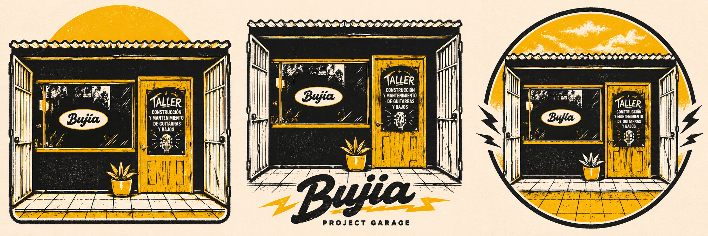 | [PNG](drafts/facade/facade-sheet-v1.4.0-badge-concepts.png) | `review` | — | Lámina de tres composiciones conservada completa. |
| `facade` | [Fachada con banqueta amarilla](drafts/facade/facade-v1.1.0-yellow-sidewalk.md) | `facade` | `ai-generated` | `1.1.0` | 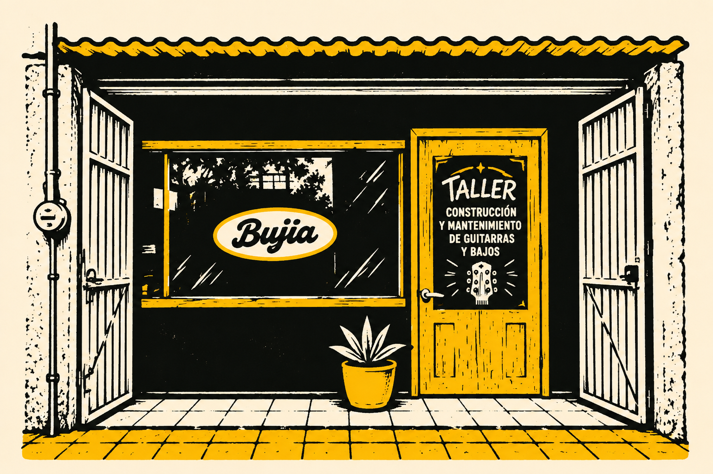 | [PNG](drafts/facade/facade-v1.1.0-yellow-sidewalk.png) | `review` | — | Ilustración individual de la fachada del taller. |
| `facade` | [Fachada con piso crema](drafts/facade/facade-v1.4.0-cream-floor.md) | `facade` | `ai-generated` | `1.4.0` | 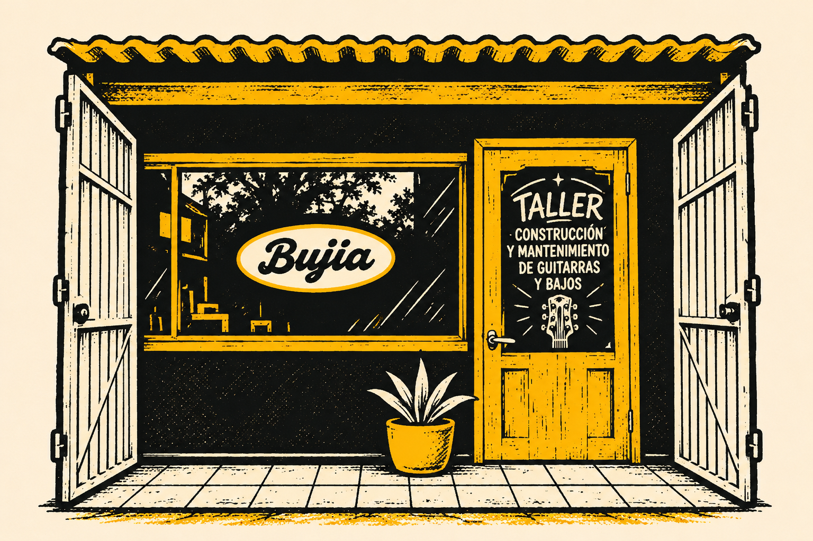 | [PNG](drafts/facade/facade-v1.4.0-cream-floor.png) | `review` | — | Ilustración individual de la fachada del taller. |
| `facade-sheet` | [Lámina de fachadas sobre blanco con logo rojo rosado](drafts/facade/facade-sheet-v1.5.0-white-background-coral-logo.md) | `facade` | `ai-generated` | `1.5.0` | 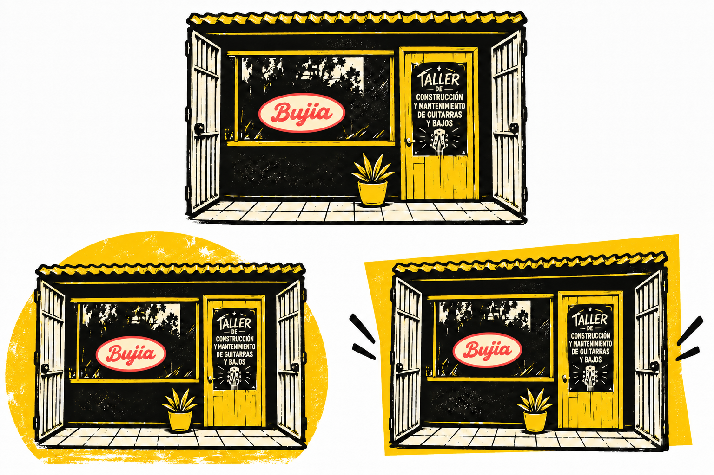 | [PNG](drafts/facade/facade-sheet-v1.5.0-white-background-coral-logo.png) | `review` | [Logo ovalado](masters/logo/bujia-oval-logo-v1.0.0-red-cream.md) | Variante con el rótulo y el contorno de la ventana en rojo rosado. |
| `facade` | [Fachada verde y crema con logo rojo rosado](drafts/facade/facade-v1.6.0-green-cream-coral-logo.md) | `facade` | `ai-generated` | `1.6.0` | 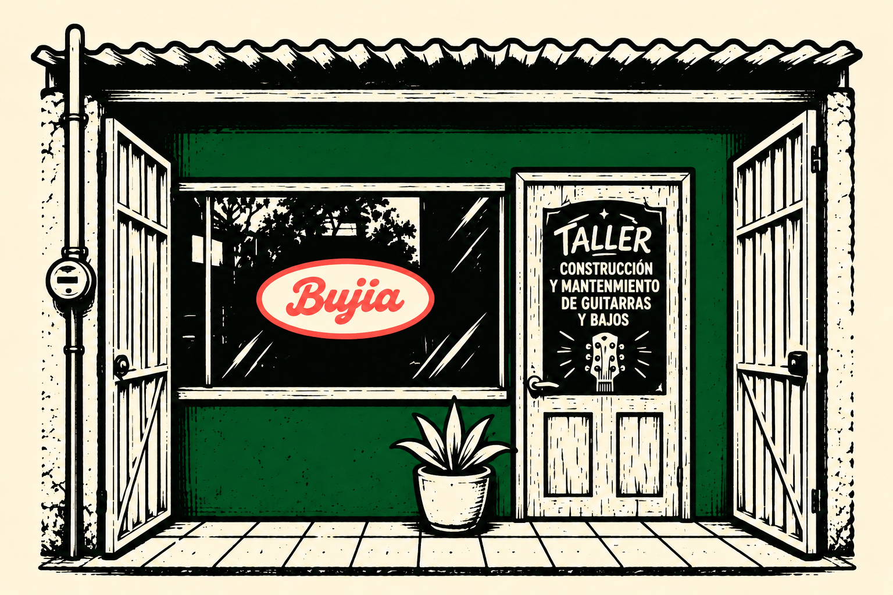 | [PNG](drafts/facade/facade-v1.6.0-green-cream-coral-logo.png) | `review` | [Logo ovalado](masters/logo/bujia-oval-logo-v1.0.0-red-cream.md) | Variante con el rótulo y el contorno de la ventana en rojo rosado. |
| `facade` | [Fachada verde y amarilla con logo rojo rosado](drafts/facade/facade-v1.7.0-green-yellow-coral-logo.md) | `facade` | `ai-generated` | `1.7.0` | 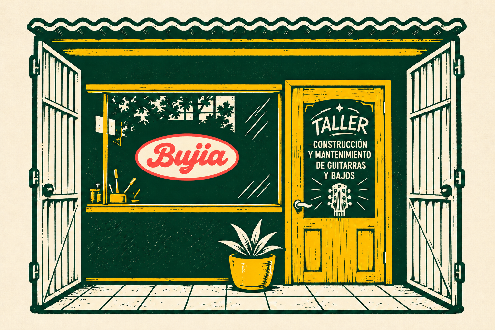 | [PNG](drafts/facade/facade-v1.7.0-green-yellow-coral-logo.png) | `review` | [Logo ovalado](masters/logo/bujia-oval-logo-v1.0.0-red-cream.md) | Variante con el rótulo y el contorno de la ventana en rojo rosado. |
| `facade-sheet` | [Lámina de fachadas sobre crema con logo rojo rosado](drafts/facade/facade-sheet-v1.6.0-cream-background-coral-logo.md) | `facade` | `ai-generated` | `1.6.0` | 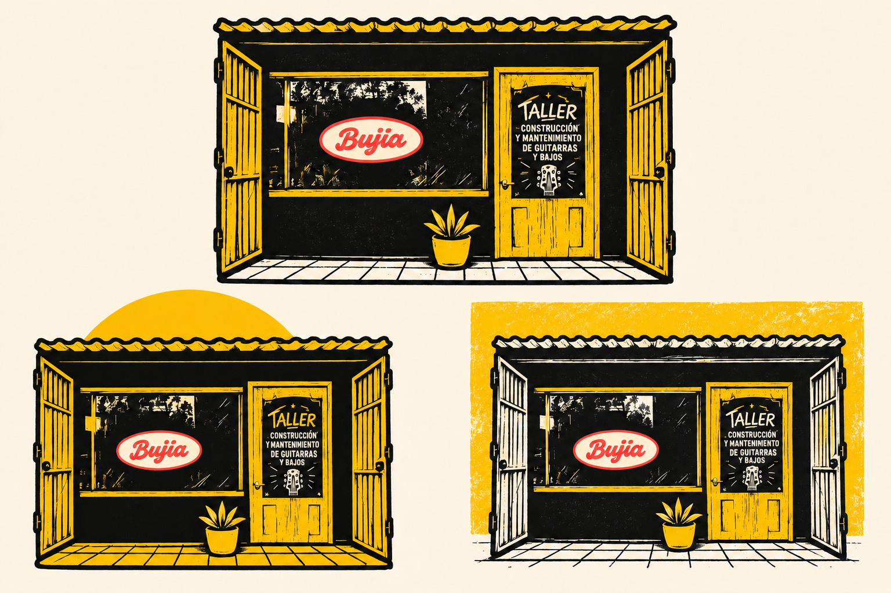 | [PNG](drafts/facade/facade-sheet-v1.6.0-cream-background-coral-logo.png) | `review` | [Logo ovalado](masters/logo/bujia-oval-logo-v1.0.0-red-cream.md) | Variante con el rótulo y el contorno de la ventana en rojo rosado. |
| `facade-sheet` | [Lámina panorámica de emblemas con logo rojo rosado](drafts/facade/facade-sheet-v1.7.0-badge-concepts-coral-logo.md) | `facade` | `ai-generated` | `1.7.0` | 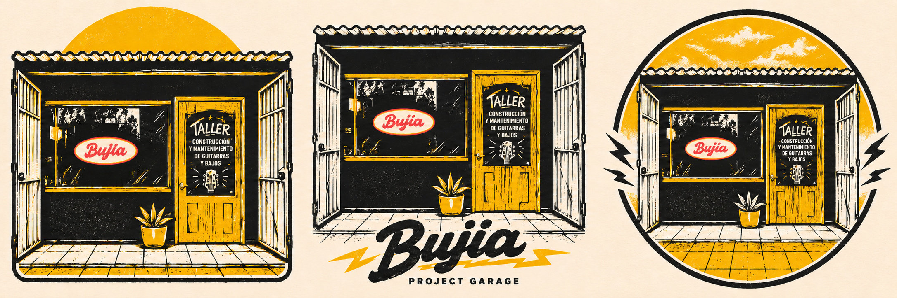 | [PNG](drafts/facade/facade-sheet-v1.7.0-badge-concepts-coral-logo.png) | `review` | [Logo ovalado](masters/logo/bujia-oval-logo-v1.0.0-red-cream.md) | Variante con el rótulo y el contorno de la ventana en rojo rosado. |
| `facade` | [Fachada con banqueta amarilla con logo rojo rosado](drafts/facade/facade-v1.5.0-yellow-sidewalk-coral-logo.md) | `facade` | `ai-generated` | `1.5.0` | 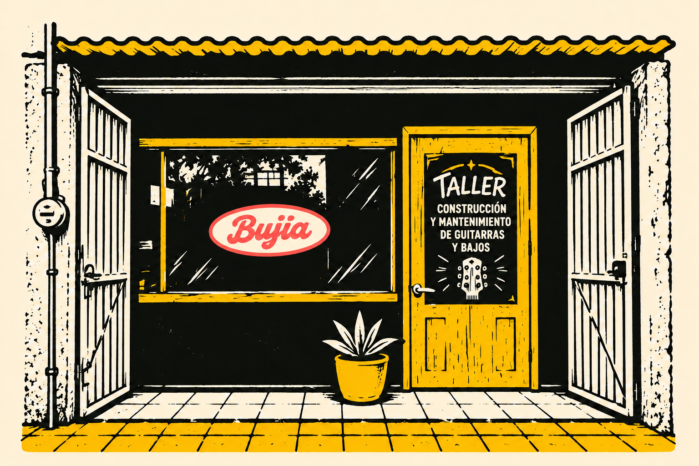 | [PNG](drafts/facade/facade-v1.5.0-yellow-sidewalk-coral-logo.png) | `review` | [Logo ovalado](masters/logo/bujia-oval-logo-v1.0.0-red-cream.md) | Variante con el rótulo y el contorno de la ventana en rojo rosado. |
| `facade` | [Fachada con piso crema con logo rojo rosado](drafts/facade/facade-v1.8.0-cream-floor-coral-logo.md) | `facade` | `ai-generated` | `1.8.0` | 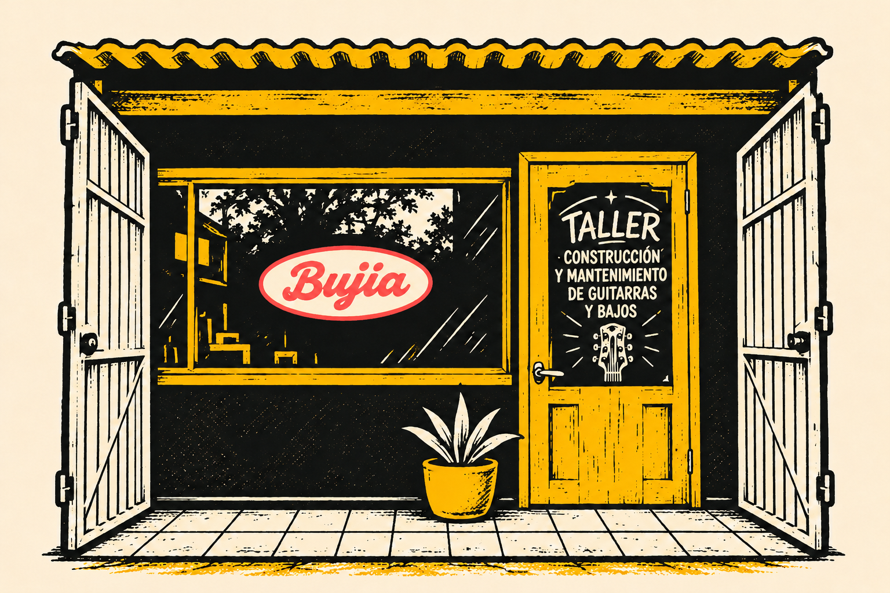 | [PNG](drafts/facade/facade-v1.8.0-cream-floor-coral-logo.png) | `review` | [Logo ovalado](masters/logo/bujia-oval-logo-v1.0.0-red-cream.md) | Variante con el rótulo y el contorno de la ventana en rojo rosado. |
| `facade-white-plain` | [Fachada sola sobre blanco](drafts/facade/facade-white-plain-v1.0.0-coral-logo.md) | `facade` | `ai-generated` | `1.0.0` | 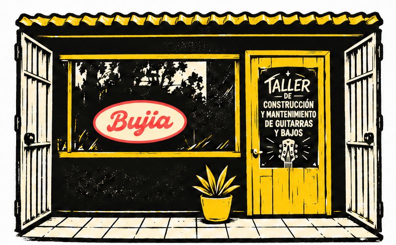 | [PNG](drafts/facade/facade-white-plain-v1.0.0-coral-logo.png) | `approved` | [Logo ovalado](masters/logo/bujia-oval-logo-v1.0.0-red-cream.md) | Propuesta individual extraída de una lámina con logo rojo rosado. |
| `facade-white-yellow-circle` | [Fachada con círculo amarillo](drafts/facade/facade-white-yellow-circle-v1.0.0-coral-logo.md) | `facade` | `ai-generated` | `1.0.0` | 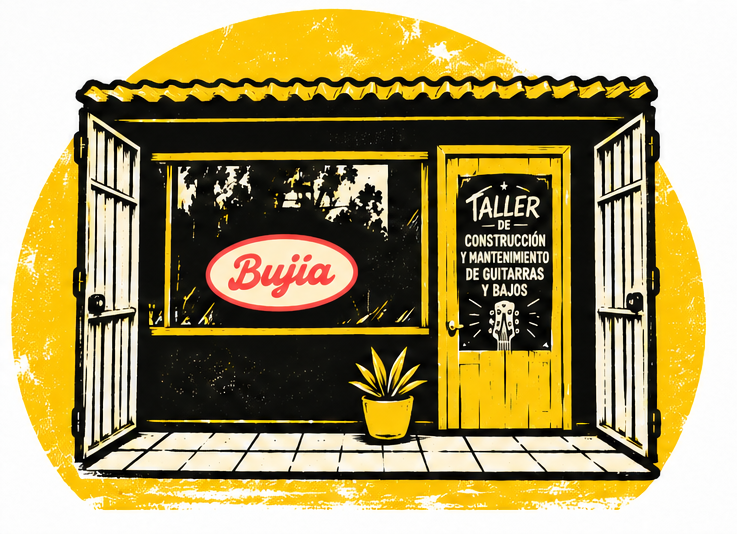 | [PNG](drafts/facade/facade-white-yellow-circle-v1.0.0-coral-logo.png) | `approved` | [Logo ovalado](masters/logo/bujia-oval-logo-v1.0.0-red-cream.md) | Propuesta individual extraída de una lámina con logo rojo rosado. |
| `facade-white-angled-rectangle` | [Fachada con rectángulo inclinado](drafts/facade/facade-white-angled-rectangle-v1.0.0-coral-logo.md) | `facade` | `ai-generated` | `1.0.0` | 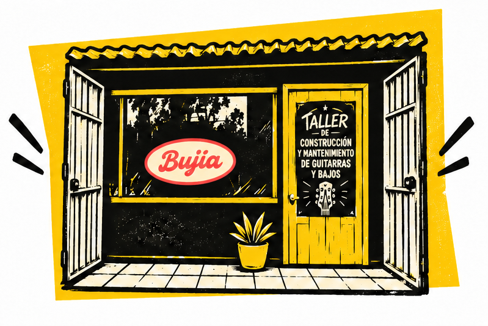 | [PNG](drafts/facade/facade-white-angled-rectangle-v1.0.0-coral-logo.png) | `approved` | [Logo ovalado](masters/logo/bujia-oval-logo-v1.0.0-red-cream.md) | Propuesta individual extraída de una lámina con logo rojo rosado. |
| `facade-cream-plain` | [Fachada sola sobre crema](drafts/facade/facade-cream-plain-v1.0.0-coral-logo.md) | `facade` | `ai-generated` | `1.0.0` | 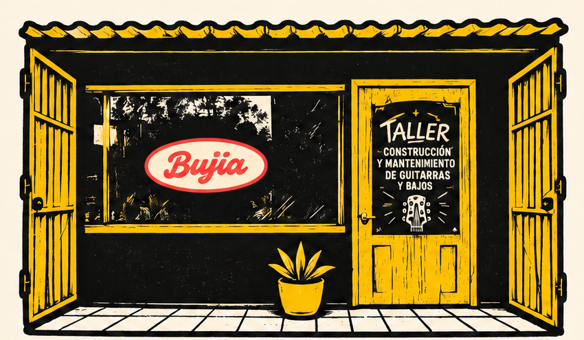 | [PNG](drafts/facade/facade-cream-plain-v1.0.0-coral-logo.png) | `approved` | [Logo ovalado](masters/logo/bujia-oval-logo-v1.0.0-red-cream.md) | Propuesta individual extraída de una lámina con logo rojo rosado. |
| `facade-cream-yellow-semicircle` | [Fachada con semicírculo amarillo](drafts/facade/facade-cream-yellow-semicircle-v1.0.0-coral-logo.md) | `facade` | `ai-generated` | `1.0.0` | 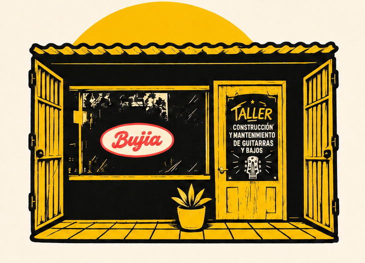 | [PNG](drafts/facade/facade-cream-yellow-semicircle-v1.0.0-coral-logo.png) | `approved` | [Logo ovalado](masters/logo/bujia-oval-logo-v1.0.0-red-cream.md) | Propuesta individual extraída de una lámina con logo rojo rosado. |
| `facade-cream-textured-rectangle` | [Fachada con rectángulo texturizado](drafts/facade/facade-cream-textured-rectangle-v1.0.0-coral-logo.md) | `facade` | `ai-generated` | `1.0.0` | 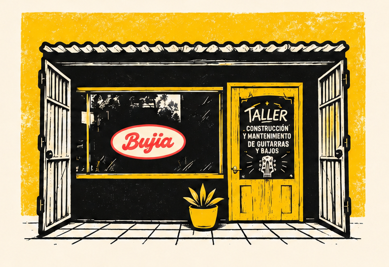 | [PNG](drafts/facade/facade-cream-textured-rectangle-v1.0.0-coral-logo.png) | `approved` | [Logo ovalado](masters/logo/bujia-oval-logo-v1.0.0-red-cream.md) | Propuesta individual extraída de una lámina con logo rojo rosado. |
| `facade-yellow-sun` | [Fachada con sol amarillo](drafts/facade/facade-yellow-sun-v1.0.0-coral-logo.md) | `facade` | `ai-generated` | `1.0.0` | 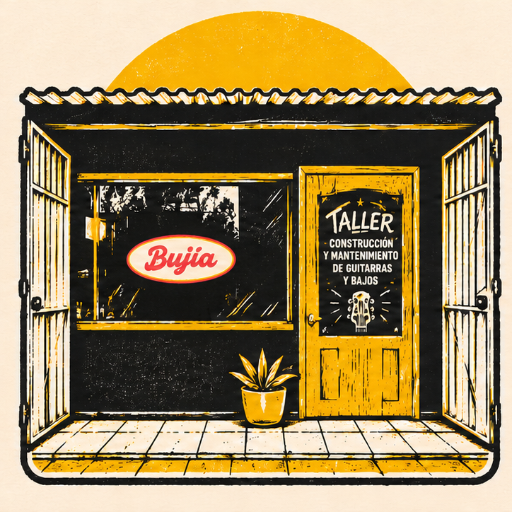 | [PNG](drafts/facade/facade-yellow-sun-v1.0.0-coral-logo.png) | `approved` | [Logo ovalado](masters/logo/bujia-oval-logo-v1.0.0-red-cream.md) | Propuesta individual extraída de una lámina con logo rojo rosado. |
| `facade-project-garage` | [Fachada con firma Bujía Project Garage](drafts/facade/facade-project-garage-v1.0.0-coral-logo.md) | `facade` | `ai-generated` | `1.0.0` | 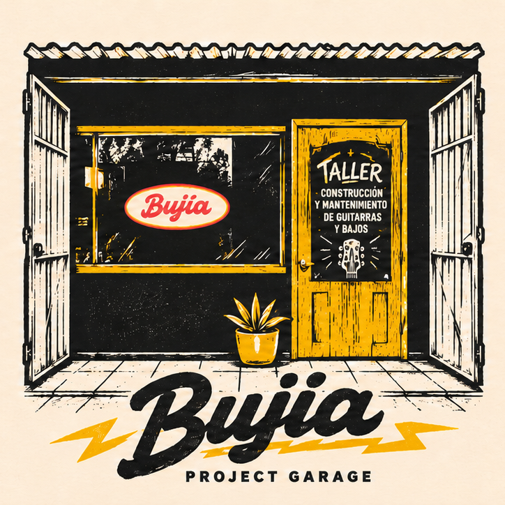 | [PNG](drafts/facade/facade-project-garage-v1.0.0-coral-logo.png) | `approved` | [Logo ovalado](masters/logo/bujia-oval-logo-v1.0.0-red-cream.md) | Propuesta individual extraída de una lámina con logo rojo rosado. |
| `facade-round-lightning-badge` | [Emblema circular con rayos](drafts/facade/facade-round-lightning-badge-v1.0.0-coral-logo.md) | `facade` | `ai-generated` | `1.0.0` | 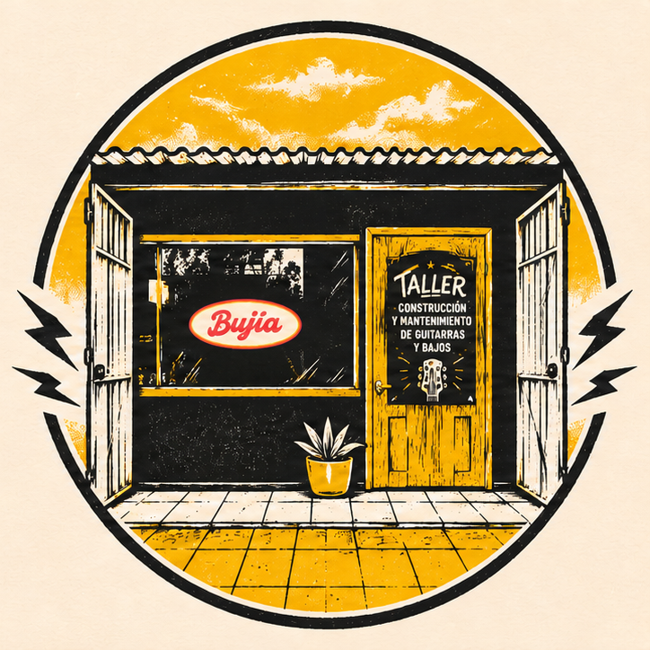 | [PNG](drafts/facade/facade-round-lightning-badge-v1.0.0-coral-logo.png) | `approved` | [Logo ovalado](masters/logo/bujia-oval-logo-v1.0.0-red-cream.md) | Propuesta individual extraída de una lámina con logo rojo rosado. |

## Elementos gráficos

| Identificador | Nombre | Categoría | Procedencia | Versión | Vista previa | Archivo | Estado | Maestra relacionada | Descripción |
| --- | --- | --- | --- | --- | --- | --- | --- | --- | --- |
| `support-local-guitar-shop` | [Apoya tu tienda local con bujía](drafts/graphic-elements/support-local-guitar-shop-v1.0.0-spark-plug.md) | `graphic-elements` | `ai-generated` | `1.0.0` | 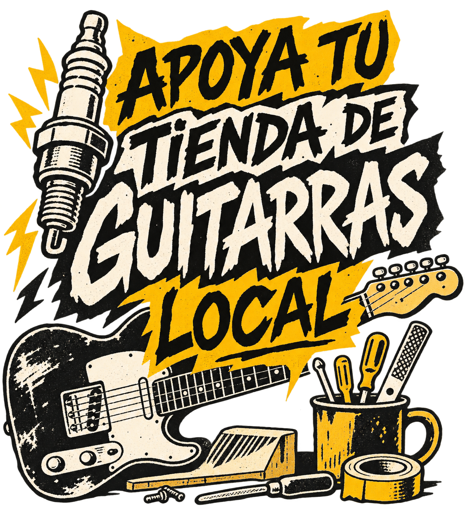 | [PNG](drafts/graphic-elements/support-local-guitar-shop-v1.0.0-spark-plug.png) | `review` | — | Letrero en negro, amarillo y crema con bujía, guitarra, taza y útiles de taller. |
| `support-local-workshop` | [Apoya a tu taller local](drafts/graphic-elements/support-local-workshop-v1.0.0-yellow-lettering.md) | `graphic-elements` | `ai-generated` | `1.0.0` | 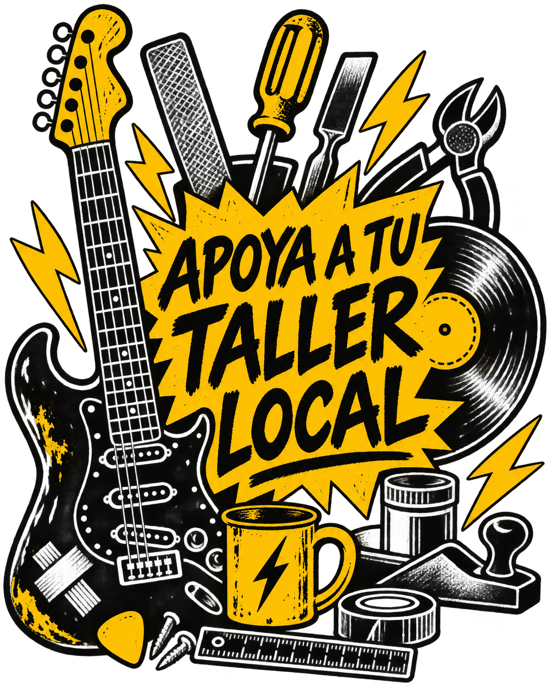 | [PNG](drafts/graphic-elements/support-local-workshop-v1.0.0-yellow-lettering.png) | `review` | — | Letras amarillas sobre negro con rayos, un clavijero y una taza. |
| `support-local-guitar-shop` | [Apoya tu tienda local con vinilo](drafts/graphic-elements/support-local-guitar-shop-v1.1.0-vinyl-and-tools.md) | `graphic-elements` | `ai-generated` | `1.1.0` | 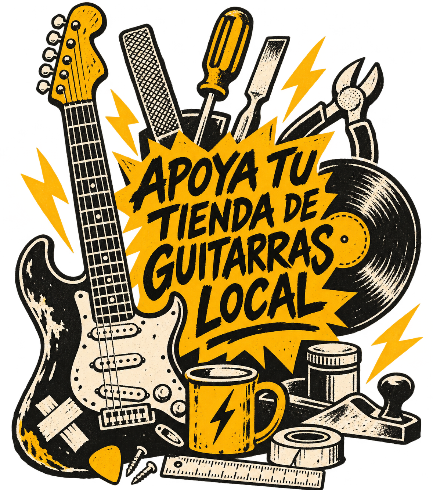 | [PNG](drafts/graphic-elements/support-local-guitar-shop-v1.1.0-vinyl-and-tools.png) | `review` | — | Lema amarillo entre guitarra, vinilo, taza y herramientas. |
| `support-local-guitar-shop` | [Apoya tu tienda local en emblema ovalado](drafts/graphic-elements/support-local-guitar-shop-v1.2.0-green-oval.md) | `graphic-elements` | `ai-generated` | `1.2.0` |  | [PNG](drafts/graphic-elements/support-local-guitar-shop-v1.2.0-green-oval.png) | `review` | — | Emblema crema y verde con guitarra eléctrica, bujía y rayos. |

## Texturas

| Identificador | Nombre | Categoría | Procedencia | Versión | Vista previa | Archivo | Estado | Maestra relacionada | Descripción |
| --- | --- | --- | --- | --- | --- | --- | --- | --- | --- |

## Fotografías

| Identificador | Nombre | Categoría | Procedencia | Versión | Vista previa | Archivo | Estado | Maestra relacionada | Descripción |
| --- | --- | --- | --- | --- | --- | --- | --- | --- | --- |
| `current-facade` | [Fachada actual · foto original](references/photography/facade/README.md) | `photography` | Fotografía | `1.0.0` | — | [HEIC](references/photography/facade/current-facade-v1.0.0.heic) | `approved` | — | Fuente de la apariencia actual del taller según el propietario. |
| `current-facade` | [Fachada actual · referencia de trabajo](references/photography/facade/README.md) | `photography` | Fotografía con retoque de IA | `1.1.0` | 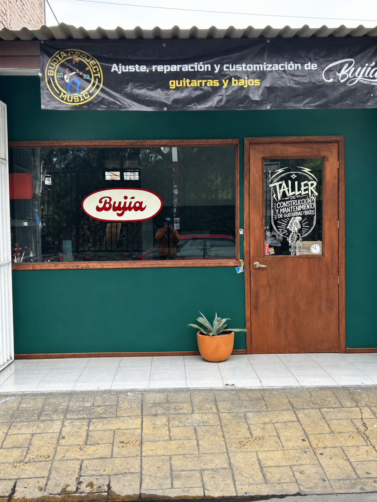 | [PNG](references/photography/facade/current-facade-v1.1.0-no-seated-person.png) | `review` | — | Copia de referencia con retoque en el muro y el piso. |

## Diseños de merchandising

| Identificador | Nombre | Categoría | Procedencia | Versión | Vista previa | Archivo | Estado | Maestra relacionada | Descripción |
| --- | --- | --- | --- | --- | --- | --- | --- | --- | --- |
| `black-t-shirt` | [Mockup de playera negra con fachada](designs/t-shirts/black-t-shirt-v1.0.0-facade-mockup.md) | `t-shirts` | `ai-generated` | `1.0.0` |  | [PNG](designs/t-shirts/black-t-shirt-v1.0.0-facade-mockup.png) | `review` | — | Vista frontal y posterior con marca al pecho e ilustración de fachada en la espalda. |
| `canvas-totebag` | [Mockup de totebags con fachada y guitarra](designs/totebags/canvas-totebag-v1.0.0-facade-and-guitar-mockup.md) | `totebags` | `ai-generated` | `1.0.0` |  | [PNG](designs/totebags/canvas-totebag-v1.0.0-facade-and-guitar-mockup.png) | `review` | — | Dos bolsas de lona con fachada y una composición de guitarra con lema en inglés. |

## Otros diseños

| Identificador | Nombre | Categoría | Procedencia | Versión | Vista previa | Archivo | Estado | Maestra relacionada | Descripción |
| --- | --- | --- | --- | --- | --- | --- | --- | --- | --- |
